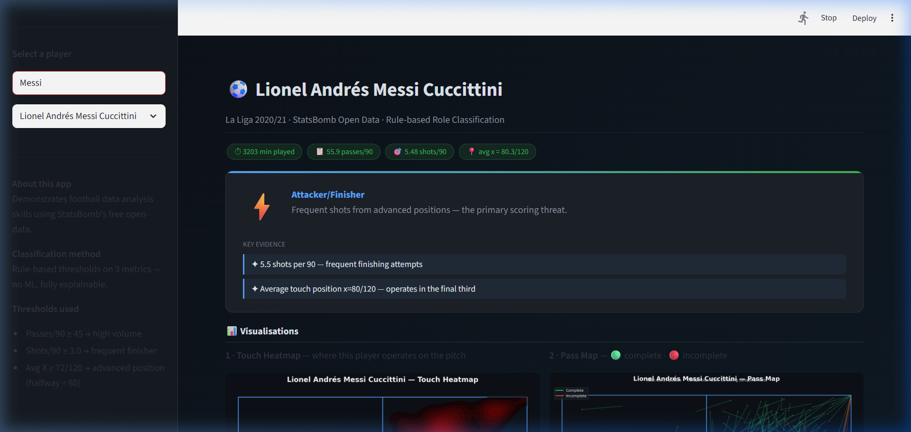

# ⚽ Football Player Style Analyzer

A Python + Streamlit app that profiles any player from La Liga 2020/21 using
StatsBomb's free open-data. Built as a portfolio project to demonstrate
football data analysis skills in a 5-minute interview walkthrough.

---

## What it does

1. Loads a player from a dropdown (150+ players available)
2. Computes **3 metrics** and assigns a **role** using fixed thresholds
3. Renders **3 visualisations** — heatmap, pass map, shot map

## App screenshot



---

## Quick start

```bash
pip install -r requirements.txt
streamlit run app.py
```

First run downloads La Liga 2020/21 from StatsBomb (~2 min).  
All later runs load from `cache/events.pkl` instantly.

---

## The 3 metrics

| Metric | Description |
|---|---|
| **Passes per 90** | Completed passes normalised to 90 minutes of play |
| **Shots per 90** | Shot attempts normalised to 90 minutes of play |
| **Average X position** | Mean x-coordinate of all touches (0=own goal, 120=opp goal) |

---

## Role classification (fixed thresholds)

| Role | Rule |
|---|---|
| **Playmaker** | Passes/90 ≥ 45 **and** Shots/90 < 3 |
| **Attacker/Finisher** | Shots/90 ≥ 3 **and** Avg X ≥ 72/120 |
| **Deep/Defensive** | Everything else (low shots, deep average position) |

Thresholds are deliberately simple and fixed — every boundary can be
explained without maths to a non-technical audience.

---

## File structure

```
Football/
├── app.py              # Streamlit UI — player dropdown → 3 plots + role
├── data_loader.py      # Fetch + cache + filter StatsBomb events
├── visuals.py          # plot_heatmap, plot_passmap, plot_shotmap
├── role_classifier.py  # compute_metrics, classify_role (3 rules)
├── requirements.txt
└── cache/              # auto-created; events.pkl written on first run
```

---

## Example players

| Player | Expected role |
|---|---|
| Lionel Messi | Attacker/Finisher (or Playmaker hybrid) |
| Karim Benzema | Attacker/Finisher |
| Sergio Busquets | Deep/Defensive |

---

## Data source

[StatsBomb Open Data](https://github.com/statsbomb/open-data) — free to use
for research and portfolio projects under the StatsBomb Open Data licence.

---

## Tech stack

`pandas` · `mplsoccer` · `statsbombpy` · `streamlit` · `matplotlib`
